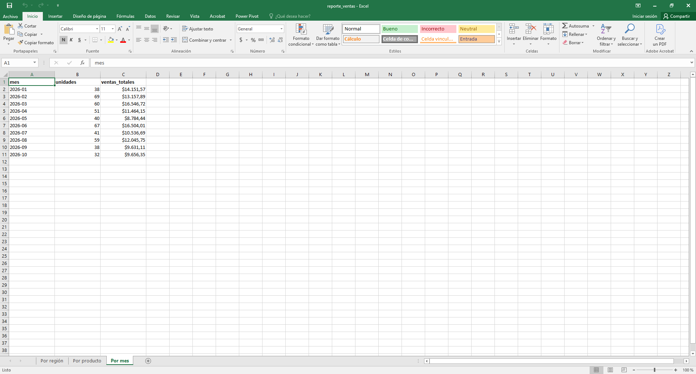
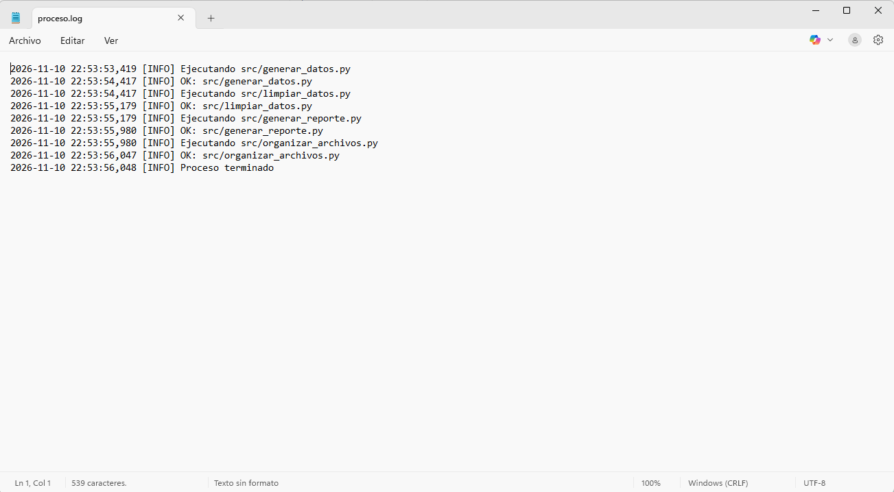

# Automatizador de archivos Excel/CSV

Script en Python que procesa archivos de ventas: genera datos de prueba, detecta y limpia errores, crea un reporte en Excel y organiza los archivos por fecha

> Proyecto de portfolio. Todos los datos son falsos (generados con Faker).

## Qué hace

1. **Genera** datos de ventas de prueba, con errores a propósito.
2. **Detecta** vacíos, duplicados y texto sucio.
3. **Limpia** los datos y guarda el resultado en 'output/'.
4. **Reporta** un excel con resúmenes por región, producto y mes.
5. **Organiza** los archivos en carpetas por fecha.
6. **Registra** cada paso en 'logs/proceso.log'.

## Tecnologías

Python, pandas, openpyxl, Faker.

## Como ejecutarlo
```powershell
python -m venv venv
.\venv\Scripts\Activate.ps1
pip install -r requirements.txt
python src/main.py
```

## Estructura

```
input/     archivos originales
output/    datos limpios y reportes
src/       código
logs/      registro de ejecuciones
```

## Capturas


